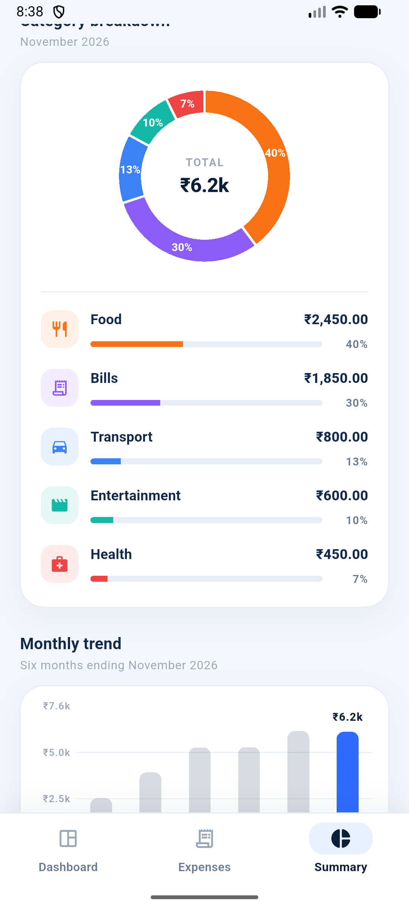
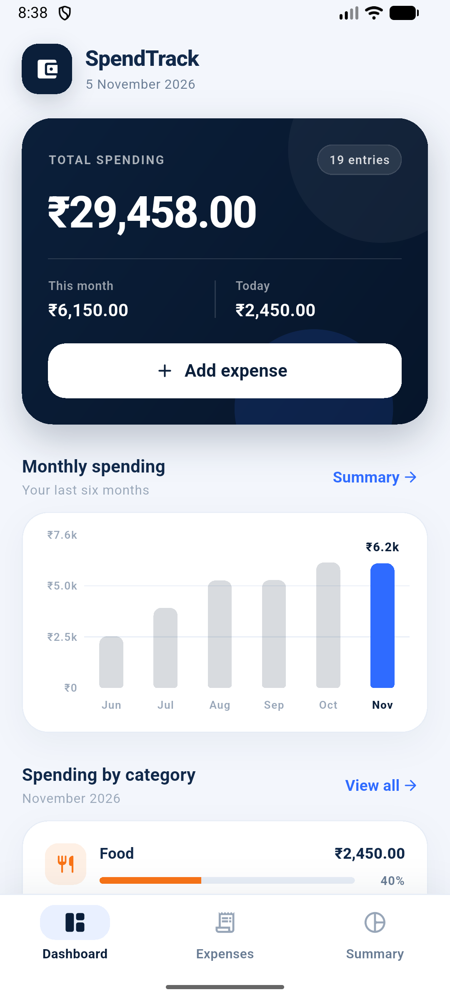

# SpendTrack

**A clean, offline-first expense tracker for Android.**

SpendTrack helps you record day-to-day spending and understand it through
month-by-month analytics. Every total, percentage, and chart in the app is
calculated from the expenses saved on the device — there are no sample records
or hardcoded analytics values.


---

## Screenshots

<table>
  <tr>
    <td align="center"><br /><sub><b>Dashboard</b> — totals, six-month trend, categories</sub></td>
    <td align="center"><br /><sub><b>Summary</b> — month filter, donut chart, percentages</sub></td>
    <td align="center"><br /><sub><b>Monthly trend</b> — category-filtered bar chart</sub></td>
  </tr>
  <tr>
    <td align="center"><br /><sub><b>Expenses</b> — search, category, and month filters</sub></td>
    <td align="center"><br /><sub><b>Add expense</b> — validation and category picker</sub></td>
    <td align="center"><br /><sub><b>Details</b> — edit and delete with confirmation</sub></td>
  </tr>
</table>

> Screenshots were captured on the Android emulator using demonstration data.
> The installed app starts empty — no demo records are bundled with it.

---

## Overview

SpendTrack is a Flutter Android application for personal expense tracking. It
combines a fast expense-entry flow with a summary module that answers practical
questions: *How much did I spend this month? How does that compare with last
month? Which categories take the largest share? How has my spending changed over
the last six months?*

The app is fully offline. Expenses are stored in a local SQLite database, and
all analytics are derived from those records by a single `ChangeNotifier`
provider. Adding, editing, or deleting an expense immediately refreshes every
affected total, percentage, and chart.

## Features

### Expense management

- Add an expense with amount, title, category, date, and an optional note.
- Edit or delete any saved expense; deletion requires confirmation.
- Form validation for empty titles, missing or non-numeric amounts, and
  zero/negative values.
- Sticky save action that stays above the software keyboard.
- Duplicate-safe saving (rapid double taps do not create duplicate records).
- Records persist across app restarts in the app's private SQLite database.
- Search transactions by title, category, or note.
- Filter the transaction list by category and by the current month.

### Analytics and summary

- **Total expenses** across everything you have recorded.
- **Today's spending** on the dashboard.
- **Current month's spending** on the dashboard and summary.
- **Category-wise totals** with icon, amount, and percentage share.
- **Category donut chart** with percentage labels and the filtered total in the
  centre (`fl_chart`).
- **Monthly bar chart** covering the six months ending at the selected month,
  with the selected month highlighted and tooltips showing exact amounts
  (`fl_chart`).
- **Month filtering** with previous/next navigation and a guard against moving
  beyond the current month.
- **Category filtering** on the Summary screen, applied consistently to the
  total, previous-month comparison, transaction count, category breakdown, and
  monthly trend.
- **Automatic updates** through `ChangeNotifier`: every mutation triggers a
  rebuild of the analytics views.
- **Meaningful empty states** for the donut chart, bar chart, filtered months,
  and the entire summary screen.
- Previous-month comparison with percentage change and an explicit
  "first month with recorded spending" state.

### Presentation and platform

- Custom navy/blue/orange visual theme with reusable cards, headers, and filter
  pills.
- Three-tab shell: Dashboard, Expenses, Summary.
- Explicit loading, load-error/retry, empty, and populated states.
- Dedicated adaptive launcher icon and Android application label `SpendTrack`.
- No network permission in the release manifest; the app works in airplane mode.

## Tech stack and dependencies

| Dependency | Version | Purpose |
| --- | --- | --- |
| Flutter SDK | 3.47.9 (stable) | Application framework |
| Dart | 3.13.7 | Language and tooling |
| `provider` | 6.1.5+1 | State management via `ChangeNotifier` |
| `sqflite` | 2.4.5 | Local SQLite persistence |
| `path` | 1.9.1 | Cross-platform database path joining |
| `intl` | 0.20.3 | Currency, date, and month formatting (en_IN) |
| `uuid` | 4.6.0 | Unique expense identifiers |
| `fl_chart` | 1.3.0 | Category pie/donut and monthly bar charts |
| `cupertino_icons` | 1.0.9 | Supporting icon assets |
| `flutter_lints` | 6.0.0 (dev) | Static analysis rules |
| `sqflite_common_ffi` | 2.4.5 (dev) | SQLite tests on the Dart VM |
| `flutter_launcher_icons` | 0.14.4 (dev) | Android launcher/adaptive icon generation |

## Architecture

SpendTrack uses a small, layered architecture. UI code never calculates
analytics directly; it reads derived values from the provider, which owns the
in-memory list and the repository abstraction.

```text
┌─────────────────────────────────────────────┐
│ Presentation                                │
│ Screens + reusable widgets                  │
│ Dashboard / Expenses / Summary / Form       │
└──────────────────────┬──────────────────────┘
                       │ context.watch / read
┌──────────────────────▼──────────────────────┐
│ State                                       │
│ ExpenseProvider (ChangeNotifier)            │
│ totals · category shares · monthly trends   │
│ optimistic mutations + rollback             │
└──────────────────────┬──────────────────────┘
                       │ ExpenseRepository
┌──────────────────────▼──────────────────────┐
│ Persistence                                 │
│ ExpenseDatabase (sqflite / SQLite)          │
└─────────────────────────────────────────────┘
```

**Key design decisions**

- **Single source of truth.** `ExpenseProvider` derives every analytics value
  from the saved expense list. The summary and dashboard pass optional month
  and category filters into the same methods, so there is no duplicated
  filtering logic in widgets.
- **Repository abstraction.** The provider depends on `ExpenseRepository`, not
  on SQLite directly. Widget tests use an in-memory fake; unit tests use
  `sqflite_common_ffi`.
- **Optimistic persistence with rollback.** UI mutations are applied
  immediately for responsiveness. If the database write fails, the previous
  list is restored and a user-facing error is shown.
- **Typed storage errors.** Database failures are wrapped in
  `StorageException` with display-safe messages, while retaining the original
  error for diagnostics.
- **Filtered analytics are pure.** `totalForMonth`, `countForMonth`,
  `totalForPreviousMonth`, `categoryTotals`, and `monthlyTotals` all accept an
  optional `ExpenseCategory` and return values computed from the same records.

### Analytics data flow

```text
Saved expense records (SQLite)
  → ExpenseProvider (sorted in memory)
    → totalAmount / todayTotal / currentMonthTotal
    → totalForMonth(month, category)
    → totalForPreviousMonth(month, category)
    → categoryTotals(month, category)
    → monthlyTotals(endMonth, count, category)
      → Dashboard / Summary widgets
        → fl_chart pie + bar charts, percentage list, total cards
```

`notifyListeners()` is called after every load, add, edit, and delete. Screens
that call `context.watch<ExpenseProvider>()` rebuild automatically, so charts
and totals never display stale data.

### Project structure

```text
lib/
├── main.dart                     # Entry point and database injection
├── app.dart                      # Provider root + MaterialApp
├── models/
│   ├── expense.dart              # Immutable expense + JSON mapping
│   ├── expense_category.dart     # Persisted category names and labels
│   └── month_total.dart          # Month + total pair for trend charts
├── services/
│   ├── expense_repository.dart   # CRUD interface + StorageException
│   └── expense_database.dart     # SQLite implementation and schema
├── providers/
│   └── expense_provider.dart     # State, mutations, analytics
├── screens/
│   ├── main_shell.dart           # Startup states + three-tab navigation
│   ├── dashboard_screen.dart
│   ├── expenses_screen.dart
│   ├── summary_screen.dart
│   ├── expense_detail_screen.dart
│   └── expense_form_screen.dart
├── widgets/
│   ├── add_expense_button.dart
│   ├── app_card.dart
│   ├── category_donut_chart.dart # fl_chart donut + percentage labels
│   ├── category_filter_bar.dart  # Shared category pills
│   ├── category_spending_list.dart
│   ├── chart_empty_state.dart    # Shared chart empty state
│   ├── empty_state_view.dart
│   ├── error_banner.dart
│   ├── error_state_view.dart
│   ├── expense_tile.dart
│   ├── month_selector.dart
│   ├── monthly_bar_chart.dart    # fl_chart bar chart + tooltips
│   ├── screen_header.dart
│   └── section_header.dart
├── theme/
│   ├── app_colors.dart
│   └── app_theme.dart
└── utils/
    ├── category_ui.dart          # Category icons and colours
    ├── formatters.dart           # Currency/date/month formatting
    └── validators.dart           # Form validation helpers

test/
├── models/expense_test.dart
├── providers/expense_provider_test.dart
├── services/expense_database_test.dart
├── utils/validators_test.dart
├── widgets/analytics_charts_test.dart
├── widget_test.dart
└── support/fake_expense_storage.dart
```

### Database schema

Database file: `spendtrack.db` in the platform databases directory.

```sql
CREATE TABLE expenses (
  id         TEXT PRIMARY KEY NOT NULL,
  title      TEXT NOT NULL,
  amount     REAL NOT NULL,
  category   TEXT NOT NULL,
  date       TEXT NOT NULL,  -- ISO-8601
  created_at TEXT NOT NULL,  -- ISO-8601
  note       TEXT
);

CREATE INDEX idx_expenses_date
  ON expenses (date DESC, created_at DESC);
```

Rows are read newest first by expense date, with creation time as a stable
tie-breaker. Category values match `ExpenseCategory.name`; unknown values fall
back to `Other` when reading legacy/corrupt rows.

## Getting started

### Prerequisites

- Flutter 3.35 or newer (verified with Flutter 3.47.9 stable / Dart 3.13.7)
- Android SDK with an emulator or a physical Android device
- Java 17 (bundled with current Android Studio)

### Install and run

```bash
git clone <repository-url> spendtrack
cd spendtrack
flutter pub get
flutter run
```

### Generate the launcher icon

The source images live in `assets/icon/` and the configuration is in
`pubspec.yaml`. Regenerate the Android mipmaps and adaptive icon with:

```bash
dart run flutter_launcher_icons
```

### Build an APK

```bash
flutter build apk --release
```

Output:

```text
build/app/outputs/flutter-apk/app-release.apk
```

Install it on a connected device:

```bash
adb install -r build/app/outputs/flutter-apk/app-release.apk
```

## Verification

Verified on **5 November 2026** on Windows with Flutter 3.47.9 stable, Dart
3.13.7, Android SDK 36, and the `Medium_Phone_API_37.0` emulator.

| Check | Result |
| --- | --- |
| `flutter analyze` | **No issues found** |
| `flutter test` | **51 tests passed** |
| `flutter build apk --release` | **Success** — `build/app/outputs/flutter-apk/app-release.apk` (49.7 MB) |
| Release APK install + launch | **Success** on `emulator-5554`; version `1.0.0` (`versionCode` 1); analytics rendered from saved records |
| Release manifest network permission | **None** (offline app) |
| Launcher icon generation | **Success** — legacy and adaptive icons generated |

**APK details**

- Path: `build/app/outputs/flutter-apk/app-release.apk`
- Size: 52,153,228 bytes (49.7 MB)
- SHA-256: `BA739E1AAF6308F8F4E3D46FCFF8529F757835BFF56706A9A82555E236244C00`
- Signing: debug keystore (`CN=Android Debug`), as configured by the default
  Flutter template. This is suitable for local testing and project submission,
  but it is **not** a Play Store release key.

**Test coverage**

The 51 automated tests cover:

- Expense serialization, category fallback, and invalid-record handling.
- SQLite CRUD, ordering, duplicate IDs, missing records, close/reopen
  persistence, and open-failure wrapping.
- Provider loading, retry, add/update/delete, optimistic rollback, duplicate
  protection, and filtered analytics.
- Analytics auto-refresh after mutations.
- Dashboard and summary totals, month navigation, category filtering, chart
  presence, and chart empty states.
- `fl_chart` pie/bar rendering, percentage section titles, and empty-state
  behaviour.
- Add/edit/delete flows, validation recovery, rapid double taps, search and
  filters, empty states, and keyboard-aware save action.

**Runtime checks on the emulator**

- Loaded 19 seeded demonstration expenses and confirmed all dashboard totals,
  category percentages, and the six-month trend matched the records.
- Selected a category on Summary and confirmed the total, transaction count,
  previous-month comparison, breakdown, and bar chart all filtered together.
- Verified the filtered bar chart and empty states for months with no matching
  records.
- Added, edited, and deleted expenses; confirmed list and analytics refresh and
  that data survives an app restart.
- Installed and launched the release APK over the debug build; it rendered the
  same persisted analytics correctly.
- Cleared app data after verification so the submitted app starts empty.

> Emulator date was 5 November 2026. Screenshots show the seeded demonstration
> dataset; they are documentation assets, not bundled app data.

## Defect log

| ID | Defect | Root cause | Resolution | Status |
| --- | --- | --- | --- | --- |
| DEF-01 | Expense edits were not reliably durable with the earlier key-value snapshot storage. | Whole-list snapshots could overwrite newer data and made per-record recovery difficult. | Migrated persistence to a normalised SQLite table with granular insert/update/delete operations. | Fixed |
| DEF-02 | A failed database write could leave the UI showing an unsaved change. | The optimistic update was not rolled back. | `ExpenseProvider` restores the previous list and shows a typed error when persistence fails. | Fixed |
| DEF-03 | Rapid double taps on **Save** could create duplicate records. | Submission was not guarded while the asynchronous save was in flight. | Added an in-flight save guard plus duplicate-ID protection in the provider and database. | Fixed |
| DEF-04 | Charts rendered a blank canvas when there was no data. | Chart widgets had no empty branch. | Added a shared `ChartEmptyState` with contextual title and guidance for both charts. | Fixed |
| DEF-05 | Category and monthly charts lacked percentage labels and exact-value tooltips. | Charts were drawn with custom painters. | Replaced both charts with `fl_chart` pie and bar charts; kept the existing widget APIs. | Fixed |
| DEF-06 | Category filtering changed the list but not the analytics totals or trend. | Analytics methods only accepted a month filter. | Added an optional `ExpenseCategory` filter to every analytics method and wired it through Summary. | Fixed |
| DEF-07 | The bar-chart empty state overflowed by 10 px at the default chart height. | The empty-state column exceeded its fixed-height container. | Made the empty state scale down within its height using a constrained `FittedBox` layout. | Fixed |
| DEF-08 | `flutter test` sometimes failed to delete `build/unit_test_assets`. | Build output on OneDrive was a reparse point that Flutter could not traverse. | Removed the generated `build` directory and rebuilt; build outputs remain Git-ignored. | Resolved (environment) |
| DEF-09 | The Android launcher showed the default Flutter name and icon. | The project still used template resources. | Set `android:label="SpendTrack"` and generated legacy + adaptive launcher icons. | Fixed |

## Team members and responsibilities

| Team member | Role | Responsibilities |
| --- | --- | --- |
| **K. Aswindatha** | Team Lead | Flutter application development, UI/UX design, project architecture, feature integration, and overall project management. |
| **P. Hemanth Kumar** | Team Member | Expense tracking functionality, database integration, income and expense management, and data handling. |
| **P. James** | Team Member | Dashboard development, reports and analytics, application testing, debugging, and documentation. |

## Security and repository hygiene

- The app makes no network requests and requests no `INTERNET` permission in
  the release manifest.
- All expense data stays in the app's private SQLite database.
- The root `.gitignore` and `android/.gitignore` exclude local and sensitive
  files, including:
  - `android/local.properties`
  - `android/key.properties`
  - `*.jks` and `*.keystore`
  - `.env` / `.env.*` (except `.env.example`)
  - `secrets.json` and `google-services.json`
  - `.dart_tool/`, `build/`, `coverage/`, IDE files, and Flutter-generated
    metadata
- No API keys, keystores, signing passwords, or local SDK paths are required by
  the application or committed to the project.
- If a release keystore is added later, keep the keystore and
  `key.properties` outside version control and supply them through the build
  environment.

### Publishing to GitHub

The project does not contain a configured remote. To publish it:

```bash
git init
git add .
git commit -m "Complete SpendTrack expense tracker"
git branch -M main
git remote add origin <your-repository-url>
git push -u origin main
```

Check the staged file list before the first push:

```bash
git status --short
git ls-files | findstr /i "key.properties .jks .keystore local.properties"
```

The last command should produce no output.

## Limitations and future enhancements

- Budgets and budget alerts are not implemented.
- Categories are fixed; custom category management is not implemented.
- CSV/PDF export and import are not implemented.
- The release APK is debug-signed; a production keystore must be configured
  before publishing to Google Play.
- Only the current month and its recent history are exposed in the summary
  filters; arbitrary date-range reports are future work.
- The UI is optimised for phones; tablet-specific layouts are future work.

## Acknowledgements

Built with [Flutter](https://flutter.dev), [Provider](https://pub.dev/packages/provider),
[sqflite](https://pub.dev/packages/sqflite), and
[fl_chart](https://pub.dev/packages/fl_chart).
