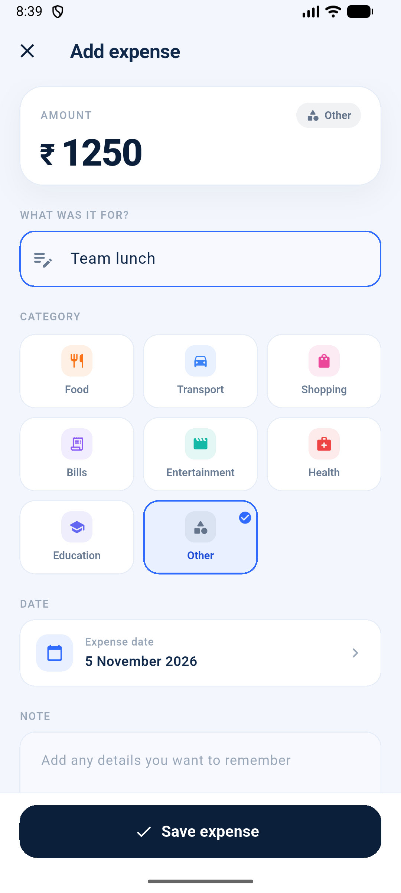
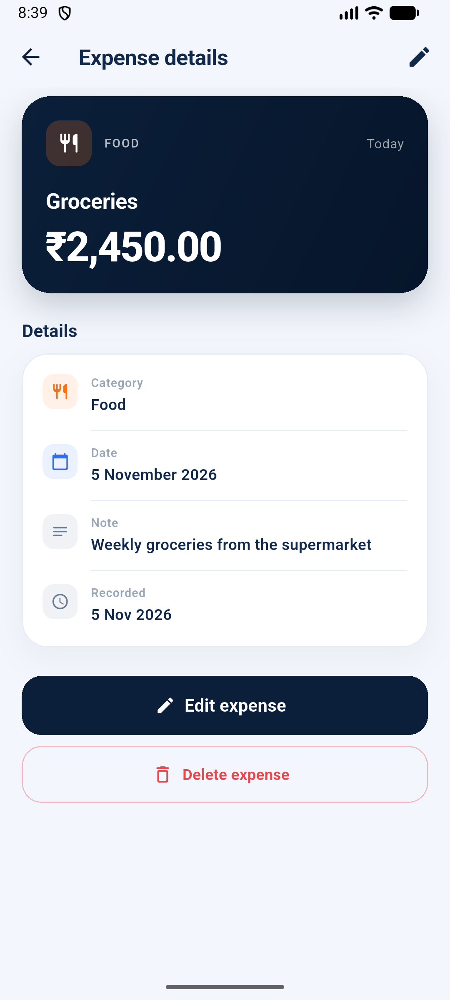
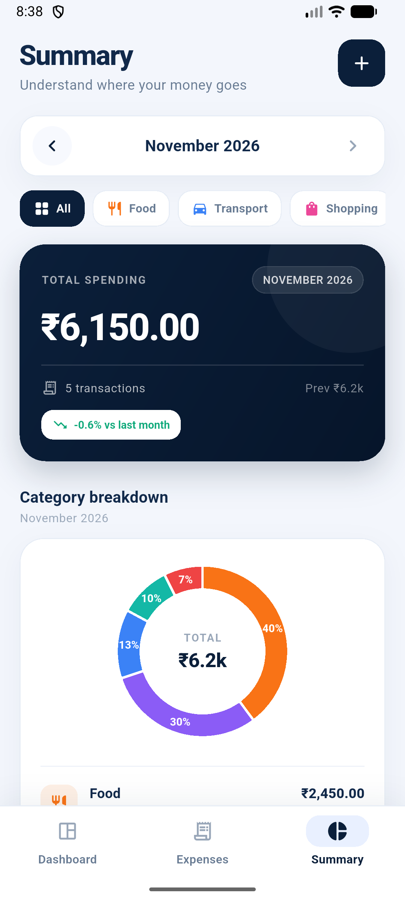

# SpendTrack

**An offline-first expense tracker for Android, built with Flutter.**

SpendTrack lets you record expenses, review spending trends, and personalize the app's appearance and display currency. Expense and preference data are stored locally in SQLite. Analytics are derived from the saved expense records; no sample records are bundled with the app.

## Features

### Dashboard and expense management

- Dashboard overview of all-time, current-month, and today's spending, with category totals, a six-month trend, and recent transactions.
- Add, view, edit, and delete expenses with an amount, title, category, date, and optional note.
- Form validation, duplicate-save protection, and a save action that remains accessible above the software keyboard.
- Search expenses by title, note, or category.
- Filter the expense list by category, current month, and an inclusive date range. Filters can be combined.
- Sort the list by newest first, oldest first, or highest amount.
- Clear all saved expenses from Settings after confirming the action.

### Summary and analytics

- Monthly totals and transaction counts, with previous-month comparisons.
- Category breakdowns with totals, percentages, and a donut chart.
- Six-month bar chart with the selected month highlighted and amount tooltips.
- Month navigation and category filtering on the Summary screen.
- Empty and error states, with analytics refreshed from Provider state after data changes.

### Settings and presentation

- Light and dark themes, saved across app restarts.
- Display currency selection, with INR as the default. Currency selection changes the displayed currency and formatting; it does **not** convert stored amounts or perform foreign-exchange calculations.
- Application information in Settings.
- Reusable visual components and theme-aware colors across screens.

## Technology and architecture

- **Flutter / Dart** — Android application UI and application logic.
- **Provider (`ChangeNotifier`)** — expense and settings state.
- **SQLite (`sqflite`)** — local expense and preference persistence.
- **`fl_chart`** — category and monthly charts.
- **`intl`** — date and currency formatting.

The UI reads state from Providers. `ExpenseProvider` uses an `ExpenseRepository` abstraction for expense operations; `SettingsProvider` uses a `SettingsRepository`. The production `ExpenseDatabase` implements both interfaces. Mutations update Provider state optimistically and restore the previous state if persistence fails.

### SQLite and migration

The database file is `spendtrack.db` in the platform's application database directory. Schema version 2 contains the expenses table and an `app_settings` key/value table. Version 2 adds the settings table to existing version 1 databases through SQLite's upgrade callback; existing expense records are preserved. Fresh installs use light theme and INR defaults until preferences are changed.

## Requirements

- Flutter **3.35 or newer** (Dart SDK **3.9 or newer**; see `pubspec.yaml`).
- Android SDK and an Android emulator or connected Android device.
- A compatible Java Development Kit. Android Studio's bundled JDK is suitable for the Android Gradle build.

## Get started

Clone the repository, then run the following from its root:

```bash
git clone <repository-url> spendtrack
cd spendtrack
flutter doctor
flutter pub get
flutter run
```

If using Android Studio, install the Android SDK platform and build tools requested by Flutter, and accept the Android SDK licenses with `flutter doctor --android-licenses` when prompted. The Android Gradle wrapper files are included in the project. Flutter creates machine-specific `android/local.properties` as needed; it should remain untracked.

### Test and analyze

```bash
flutter analyze
flutter test
```

### Build and install a release APK

```bash
flutter build apk --release
adb install -r build/app/outputs/flutter-apk/app-release.apk
```

Build output is generated under `build/` and is excluded from Git. The local release build uses the default Flutter debug signing configuration unless a release signing setup is supplied separately. Never commit signing keys or signing credentials.

### Regenerate the launcher icons (optional)

The icon sources and `flutter_launcher_icons` configuration are in `assets/icon/` and `pubspec.yaml`:

```bash
dart run flutter_launcher_icons
```

## Project structure

```text
lib/
├── main.dart
├── app.dart
├── models/       # Expense, categories, app settings, currency, sorting
├── providers/   # Expense and settings ChangeNotifiers
├── screens/     # Dashboard, expenses, summary, settings, forms and details
├── services/    # Expense/settings repositories and SQLite implementation
├── theme/       # Theme-aware palette and light/dark Material themes
├── utils/       # Filtering, formatting, validation and category presentation
└── widgets/     # Shared cards, charts, filters, headers and expense rows

test/
├── audit/       # Quality, navigation, and layout checks
├── models/
├── providers/
├── services/
├── utils/
├── widgets/
└── support/     # In-memory repository used by tests

android/         # Android project and Gradle wrapper
assets/icon/     # Launcher icon sources
docs/screenshots/ # UI screenshots (demonstration data)
```

Screenshots use demonstration data for illustration. The installed app starts without seeded expenses.

## Application Screenshots


*Dashboard — spending totals, recent transactions, and trends.*


*Add Expense — enter an amount, category, date, and optional note.*


*Expense Details — review a saved transaction and its information.*


*Summary — monthly spending and category analytics.*

## Verification

Latest verified project checks:

| Command | Result |
| --- | --- |
| `flutter analyze` | Passed — no issues found |
| `flutter test` | Passed — 67 tests |

The automated suite covers expense and settings persistence, database reopen behavior, filtering and sorting, Provider updates and rollback, analytics, charts, UI flows, theme/currency selection, and confirmed clear-all behavior.

## Project team

1. M. Abhiram
2. P. Pavan Kumar Reddy
3. P. Charan

### Individual Contributions

- **M. Abhiram — Project Lead & Frontend Development**
  - Project planning and architecture
  - Flutter UI/UX and screen development
  - Provider state management and feature integration
  - Navigation, theme integration and final deployment
- **P. Pavan Kumar Reddy — Database & Expense Management**
  - SQLite database design and integration
  - Expense and income CRUD operations
  - Data validation and local persistence
  - Search, filtering and sorting
- **P. Charan — Analytics, Testing & Documentation**
  - Dashboard and expense summaries
  - Monthly and category-wise analytics
  - Charts and graphical reports
  - Testing, bug fixing and documentation

## Repository and security notes

- Expense and app preference data are stored locally in the app's private database.
- Keep `android/local.properties`, `android/key.properties`, signing keys, `.env` files, API tokens, and other secrets out of version control.
- Flutter build output, Dart tool state, and IDE files are excluded by `.gitignore` rules.
- Review `git status --short` and the complete diff before staging or submitting changes.

## Acknowledgements

Built with [Flutter](https://flutter.dev), [Provider](https://pub.dev/packages/provider), [sqflite](https://pub.dev/packages/sqflite), and [fl_chart](https://pub.dev/packages/fl_chart).
